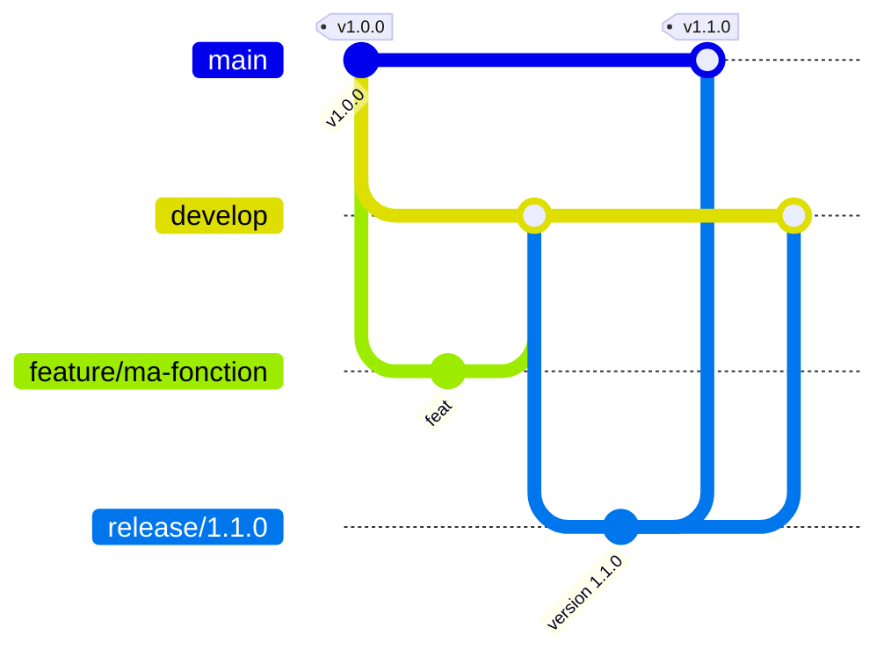

# API éligibilité livraison express

[](LICENSE)


[](https://github.com/Min3r0/Industrialisation_IA_Cloud/actions/workflows/ci.yml)
[](https://github.com/Min3r0/Industrialisation_IA_Cloud/actions/workflows/release.yml)

Industrialisation du notebook `project_test_v1_final_final2.ipynb` en une API FastAPI qui prédit si une commande est éligible à la livraison express. Projet réalisé dans le cadre du cours « Industrialisation de l'IA dans le cloud » (Master 2 Expert en Intelligence Artificielle).

- **Contrat d'API** : [`openapi.yml`](openapi.yml)
- **Architecture** (ports et adaptateurs, SOLID) : [`docs/architecture.md`](docs/architecture.md)
- **Décisions d'architecture** : [`docs/adr/`](docs/adr)

## Sommaire

- [Démarrage](#démarrage)
- [Lancer avec Docker](#lancer-avec-docker-adr-0009)
- [Entraînement et suivi MLflow](#entraînement-et-suivi-mlflow-adr-0007)
- [Clés d'API](#clés-dapi-adr-0006)
- [Configuration](#configuration-variables-denvironnement)
- [Intégration continue et publication](#intégration-continue-et-publication-adr-0010)
- [Organisation du code](#organisation-du-code)
- [Contribuer](#contribuer)
- [Sécurité](#sécurité)
- [Licence](#licence)

## Démarrage

Prérequis : Python 3.10 ou plus récent, Git.

**Windows (PowerShell)**

```powershell
git clone https://github.com/Min3r0/Industrialisation_IA_Cloud.git
cd Industrialisation_IA_Cloud
python -m venv .venv
.venv\Scripts\Activate.ps1
pip install -e ".[dev]"
python scripts/train.py --version 1.0.0     # trace le run dans MLflow, publie artifacts/models/1.0.0
pytest
uvicorn express_delivery.main:app --reload  # http://localhost:8000/docs
```

**Linux / macOS (bash)**

```bash
git clone https://github.com/Min3r0/Industrialisation_IA_Cloud.git
cd Industrialisation_IA_Cloud
python -m venv .venv
source .venv/bin/activate
pip install -e ".[dev]"
python scripts/train.py --version 1.0.0     # trace le run dans MLflow, publie artifacts/models/1.0.0
pytest
uvicorn express_delivery.main:app --reload  # http://localhost:8000/docs
```

La racine `/` renvoie 404 (aucune route dans le contrat) : l'interface de test est `/docs`.

## Lancer avec Docker (ADR-0009)

Prérequis : Docker Desktop (Windows / macOS) ou Docker Engine avec Compose v2, démarré. Il faut au moins un modèle publié dans `artifacts/models/` (voir [Entraînement](#entraînement-et-suivi-mlflow-adr-0007)) : l'image n'en contient pas, il est monté en lecture seule.

```bash
cp .env.example .env              # PowerShell : copy .env.example .env   (facultatif)
docker compose up --build -d      # http://127.0.0.1:8000/docs
docker compose ps                 # état « (healthy) » attendu
docker compose down
```

```bash
docker build --target test .      # lance les tests dans l'image
```

L'image est construite en plusieurs étapes, sur des dépendances verrouillées par empreinte (`requirements/prod.lock`). Elle tourne sous un utilisateur non root, sans pip, avec `APP_ENV=prod` par défaut ; Compose ajoute un système de fichiers en lecture seule, aucune capacité Linux et des limites de ressources. Taille : 560 Mo sur disque, 132 Mo compressés ; Trivy : aucune vulnérabilité HIGH/CRITICAL au 27/10/2026.

Compression, scan de sécurité, épinglage de l'image de base et mise à jour des dépendances : [`docs/docker.md`](docs/docker.md).

## Entraînement et suivi MLflow (ADR-0007)

`scripts/train.py` enchaîne `PipelineFactory` → `TrainTestSplitter` → `ModelEvaluator` via `ModelTrainer`, enregistre le run dans MLflow (paramètres, métriques, modèle) puis publie la version dans `artifacts/models/<X.Y.Z>/` ; le `run_id` est écrit dans `manifest.json`.

```bash
python scripts/train.py --version 1.1.0                 # une version publiée est immuable : incrémenter
python scripts/train.py --version 1.2.0 --no-tracking   # sans MLflow
mlflow ui --backend-store-uri sqlite:///mlflow.db       # http://localhost:5000
```

L'API ne dépend pas de MLflow : elle charge toujours `artifacts/models/$MODEL_VERSION` ([ADR-0002](docs/adr/ADR-0002-stockage-artefacts-modele.md)).

## Clés d'API (ADR-0006)

En dev l'authentification est désactivée. Pour la tester localement, en trois étapes.

1. Générer une clé (`--id` est seulement le nom du client à qui elle est destinée) :

   ```bash
   python scripts/create_api_key.py --id front --role user --days 30
   ```

   Le script affiche la **clé** (`sk_dev_…`, à donner au client) et l'**entrée** `front:<empreinte>:user:<date>` à mettre dans `API_KEYS`.

2. Définir les variables d'environnement **dans le terminal qui lancera uvicorn**, en remplaçant l'exemple par l'entrée affichée :

   **Windows (PowerShell)** — `set` ne fonctionne pas ici, il faut `$env:` :

   ```powershell
   $env:AUTH_ENABLED = "true"
   $env:API_KEYS = "front:<empreinte>:user:<date>"
   uvicorn express_delivery.main:app
   ```

   **Linux / macOS (bash)** :

   ```bash
   export AUTH_ENABLED=true
   export API_KEYS="front:<empreinte>:user:<date>"
   uvicorn express_delivery.main:app
   ```

   Au démarrage, le message `Authentification désactivée` ne doit **pas** apparaître. Les variables ne valent que pour ce terminal.

3. Appeler ensuite les routes `/v1/*` avec l'en-tête `X-API-Key: <clé>` (bouton *Authorize* de `/docs`). Réponses : 401 clé absente/invalide/expirée, 403 rôle insuffisant, 429 trop de requêtes (en-tête `Retry-After`).

## Configuration (variables d'environnement)

| Variable | Défaut | Rôle |
|---|---|---|
| `APP_ENV` | `dev` | Environnement courant |
| `MODELS_DIR` | `artifacts/models` | Dépôt des versions de modèle (ADR-0002) |
| `MODEL_VERSION` | `1.0.0` | Version de modèle servie |
| `DATABASE_PATH` | `data/orders.db` | Fichier SQLite des commandes (ADR-0001) |
| `PREDICTION_THRESHOLD` | `0.5` | Seuil de décision |
| `AUTH_ENABLED` | `false` (`true` si `APP_ENV=prod`, obligatoire) | Exige une clé d'API sur `/v1/*` (ADR-0006) |
| `API_KEYS` | vide | Empreintes des clés `id:sha256:rôle:AAAA-MM-JJ;…` — secret Key Vault en prod |
| `RATE_LIMIT_PER_MINUTE` | `60` | Requêtes par minute et par clé, par instance (ADR-0005) |
| `EXPOSE_DOCS` | `true` (`false` si `APP_ENV=prod`) | Expose `/docs`, `/redoc`, `/openapi.json` |
| `RANDOM_SEED` | `42` | Graine de la génération des données, du split et du modèle |
| `MLFLOW_TRACKING_URI` | `sqlite:///mlflow.db` | Base de suivi MLflow (entraînement uniquement, ADR-0007) |
| `MLFLOW_EXPERIMENT_NAME` | `livraison-express` | Expérience MLflow des runs d'entraînement |

Aucun secret ne doit être écrit dans le code ni commité : utiliser des variables d'environnement (fichiers `.env` ignorés par Git).

## Intégration continue et publication (ADR-0010)

GitHub Actions vérifie chaque pull request vers `develop` et `main` ([`ci.yml`](.github/workflows/ci.yml)) :

| Job | Vérifie |
|---|---|
| Analyse statique (pylint) | `pylint src scripts` et `pylint tests` : aucune erreur ni alerte, note ≥ 9,0 (règles dans `pyproject.toml`) |
| Tests (pytest) | les 68 tests ; rapport JUnit en artefact |
| Image Docker | hadolint, puis `docker build --target test` (tests dans l'image) |

À chaque **release GitHub publiée** (`vX.Y.Z` sur `main`), [`release.yml`](.github/workflows/release.yml) rejoue la CI, vérifie que le tag correspond à la version du code, démarre l'image pour la tester, la scanne avec Trivy puis la publie :

```bash
docker pull ghcr.io/min3r0/industrialisation_ia_cloud:1.0.0
```

Reproduire la CI en local, configurer GitHub, dépannage : [`docs/ci.md`](docs/ci.md).

## Organisation du code

```text
src/express_delivery/
├── domain/          # Objets métier purs (Order, PredictionResult, ModelMetadata, sécurité)
├── abstractions/    # Ports (ABC) : OrderStore, ModelRepository, ApiKeyStore, RateLimiter, ExperimentTracker
├── infrastructure/  # Adaptateurs : sqlite, memory, env, filesystem, tracking (MLflow)
├── ml/              # Données et entraînement, une classe par responsabilité
├── services/        # Cas d'usage : OrderService, PredictionService, AuthService
└── api/             # FastAPI : routers, schémas, sécurité, composition root (app.py)
scripts/             # train.py, create_api_key.py
requirements/        # dépendances verrouillées (prod.lock, test.lock, lint.lock)
tests/               # pytest (unitaires, contrat OpenAPI, intégration MLflow)
docs/                # architecture.md, docker.md, ci.md et ADR
.github/workflows/   # CI (pytest, pylint, image) et publication de l'image à la release
Dockerfile           # image multi-étapes : builder, test, runtime
docker-compose.yml   # lancement local durci de l'image
```

Détails et correspondance cellule du notebook → module : [`docs/architecture.md`](docs/architecture.md).

| ADR | Sujet |
|---|---|
| [0001](docs/adr/ADR-0001-stockage-commandes-clients.md) | Stockage des commandes clients |
| [0002](docs/adr/ADR-0002-stockage-artefacts-modele.md) | Stockage des artefacts du modèle |
| [0003](docs/adr/ADR-0003-hebergement-plateforme-deploiement.md) | Plateforme de déploiement et hébergement |
| [0004](docs/adr/ADR-0004-strategie-deploiement-blue-green.md) | Déploiement Blue / Green |
| [0005](docs/adr/ADR-0005-securite-entrees-sorties.md) | Sécurité des entrées et sorties |
| [0006](docs/adr/ADR-0006-securite-acces-donnee.md) | Sécurité de l'accès à la donnée |
| [0007](docs/adr/ADR-0007-suivi-experiences-mlflow.md) | Suivi MLflow et découpage du code ML |
| [0008](docs/adr/ADR-0008-workflow-git-gitflow.md) | Workflow Git : Gitflow |
| [0009](docs/adr/ADR-0009-conteneurisation-image-docker.md) | Conteneurisation : image Docker |
| [0010](docs/adr/ADR-0010-integration-continue-github-actions.md) | Intégration continue et publication de l'image (GitHub Actions) |

## Contribuer

Le dépôt suit **Gitflow** : `main` (versions publiées, taguées `vX.Y.Z`), `develop` (intégration), et des branches `feature/*`, `release/*`, `hotfix/*`.



Toute contribution passe par une pull request vers `develop`. Lire [CONTRIBUTING.md](CONTRIBUTING.md) avant de commencer et respecter le [Code de conduite](CODE_OF_CONDUCT.md).

## Sécurité

Ne signalez pas une vulnérabilité dans une issue publique : la procédure est décrite dans [SECURITY.md](SECURITY.md).

## Licence

Distribué sous licence MIT : voir [LICENSE](LICENSE).
