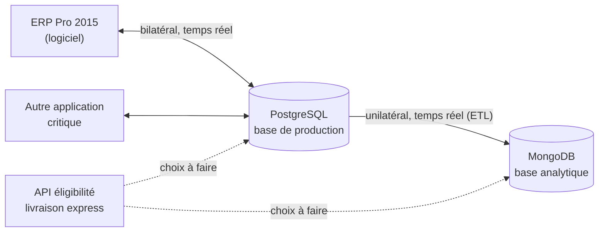

# ADR-0011 — Source des données de commandes : PostgreSQL ou MongoDB

**Status :** Accepté
**Date :** 29/10/2026
**Séance :** 4

## Contexte

Jusqu'ici, l'entraînement et la prédiction utilisent un jeu **synthétique** (`generate_orders_dataset`, voir `src/express_delivery/ml/dataset.py`). Le TP 4 demande de brancher l'application sur une **vraie source de commandes** via une nouvelle implémentation de `OrderRepository`, en choisissant **une seule** des deux bases de l'entreprise.

Ce que l'on sait des deux bases (informations des développeurs, schéma de l'alternant, simulateur `tp4-bdd.zip`) :

| | PostgreSQL | MongoDB |
|---|---|---|
| Rôle | **Base de production** de l'ERP, échange bilatéral en temps réel | **Base analytique** alimentée par un ETL à sens unique, créée pour les Data Analysts |
| Historique | Depuis 2015 (simulateur : 10 000 commandes 2015-2022 + 1 000 depuis 2023) | Depuis 2023 seulement (historique antérieur non copié) |
| Schéma | Modifié en 2017 et 2023 ; `weekend` = `NULL` avant 07/2015, `preparation_time_min` = `NULL` avant 07/2017 | Documents `orders`, toutes les colonnes renseignées (données post-2023) |
| Autres usages | Partagée avec **une autre application critique** | Réservée aux services Data |
| Exploitation | **Plus d'administrateur depuis 2023**, pas de mise à jour depuis | Maintenue par un **alternant en fin de contrat** |
| Accès (TP) | `localhost:5432`, `livraison` / `livraison`, `public.orders` | `localhost:27017`, **sans authentification**, `livraison_express.orders` |
| Client Python | `psycopg` | `pymongo` |

Historique notable : la base MongoDB a été créée **parce que les Data Analysts cassaient la base de production**.

Forces en présence :

- l'application est un **consommateur Data** (entraînement, prédiction, batch) : elle lit beaucoup et de façon répétée (réentraînements) ;
- une panne ou un ralentissement de PostgreSQL arrête l'ERP **et** une application critique ;
- le modèle doit être entraîné sur des données **représentatives d'aujourd'hui** (dérive de données) ;
- principe du cours : **ne jamais intégrer directement sur la base de production**, passer par une base analytique ou une réplique, et **valider les données dans l'application** sans faire confiance à leur qualité.

## Options considérées

| Critère | A. PostgreSQL (production) | B. **MongoDB (analytique)** |
|---|---|---|
| Risque pour la production | ❌ Requêtes lourdes (entraînement, `get_all`) sur la base de l'ERP et d'une application critique ; une erreur d'écriture modifie la production | ✅ Isolée par l'ETL à sens unique : rien de ce que fait l'application ne remonte vers la production |
| Usage prévu de la base | ❌ Base transactionnelle, pas faite pour les lectures massives | ✅ Créée exactement pour les usages Data |
| Volume d'historique | ✅ Depuis 2015 | ⚠️ Depuis 2023 (≈ 3 ans) |
| Qualité / homogénéité | ⚠️ Trois schémas successifs, valeurs `NULL` à imputer avant 2017 | ✅ Uniquement des données au schéma actuel |
| Représentativité | ⚠️ 2015-2022 : contexte métier probablement différent (dérive) | ✅ Données récentes |
| Fraîcheur | ✅ Temps réel | ✅ Temps réel via l'ETL (à surveiller) |
| Sécurité | ⚠️ Authentification, mais identifiants partagés et faibles, pas de DBA pour créer un compte dédié | ❌ Aucune authentification (à corriger, voir Conséquences) |
| Exploitation | ❌ Plus d'administrateur, versions non mises à jour depuis 2023 | ⚠️ Alternant sur le départ (bus factor = 1) |
| Contrat de données | ✅ Schéma typé par la table | ⚠️ Pas de schéma imposé : validation côté application obligatoire |
| Théorème CAP | Instance unique : CA | Instance unique : CA (en replica set, CP par défaut) — non discriminant ici |

Option écartée sans tableau : **lire les deux bases** (historique PostgreSQL + flux MongoDB). Le TP impose une seule implémentation, et cette option cumulerait les risques des deux (production sollicitée + deux sources à réconcilier).

## Décision

**Option B — MongoDB, base analytique**, collection `livraison_express.orders`, via une classe `MongoOrderRepository` (module `pymongo`) derrière l'abstraction de dépôt.

Raisons, par ordre d'importance :

1. **Ne pas mettre en danger la production.** PostgreSQL sert l'ERP et une application critique, sans administrateur pour diagnostiquer un incident. Un entraînement qui lit toute la table, ou un bug d'écriture, peut les dégrader. L'ETL unilatéral garantit au contraire qu'une erreur côté MongoDB **ne modifie jamais** la production.
2. **C'est la base prévue pour notre usage.** Elle a été créée pour séparer les consommateurs Data de la production ; s'y brancher respecte cette séparation au lieu de recréer le problème que l'entreprise a voulu résoudre.
3. **Des données homogènes et récentes.** Les données depuis 2023 ont toutes les colonnes renseignées : pas d'imputation de `weekend` ni de `preparation_time_min`, pas de mélange de trois versions de schéma, moins de dérive. Trois ans de commandes restent un volume suffisant pour un modèle tabulaire (le modèle actuel s'entraîne sur 6 000 lignes).
4. **Le manque d'historique est contournable, l'atteinte à la production ne l'est pas.** Si un jour l'historique 2015-2022 est nécessaire, il fera l'objet d'un **export ponctuel et contrôlé** vers MongoDB (ou d'une réplique PostgreSQL), jamais d'une connexion permanente de l'application à la production.

Règles d'intégration :

- **Lecture seule** sur `orders` : l'application n'écrit jamais dans la collection alimentée par l'ETL. Les commandes reçues par `POST /v1/orders` restent dans le stockage propre à l'API (`OrderStore`, [ADR-0001](ADR-0001-stockage-commandes-clients.md) / [ADR-0003](ADR-0003-hebergement-plateforme-deploiement.md)).
- Le dépôt de lecture est une **interface séparée** de `OrderStore` (ségrégation des interfaces) : l'entraînement dépend d'un port de lecture (`get`, `get_all`), pas d'une méthode `save` qu'il n'utilise pas.
- **Connexion par variable d'environnement** `MONGO_URI` (jamais dans le code ni dans Git) ; en test/prod, la valeur vient de Key Vault ([ADR-0006](ADR-0006-securite-acces-donnee.md)).
- **Validation à la lecture** : chaque document est converti en objet du domaine et contrôlé (types, bornes, valeurs autorisées) ; un document invalide est rejeté et compté dans les logs, il ne fait pas échouer tout le chargement.
- Lectures **paginées / filtrées** (par `order_date`, index existant sur `order_id`) et **projection** des seuls champs utiles.

## Conséquences

Positives :

- Aucune charge ni risque d'écriture sur la base de production.
- Le code ML ne change pas : seule une nouvelle classe d'infrastructure est ajoutée et injectée (principes ouvert/fermé et d'inversion des dépendances). `InMemoryOrderRepository` reste utilisée pour les tests unitaires.
- Pas de gestion des `NULL` historiques dans le prétraitement.

Négatives et actions :

| Risque | Action |
|---|---|
| MongoDB **sans authentification** | Avant test/prod : activer l'authentification, créer un utilisateur **lecture seule** sur `livraison_express` (rôle `read`), TLS ; `MONGO_URI` dans Key Vault |
| Alternant en fin de contrat (une seule personne connaît l'ETL) | Demander la documentation de l'ETL et une passation avant son départ ; désigner un responsable ; ajouter un contrôle de **fraîcheur** (date de la dernière commande) à `/health/ready` ou au futur orchestrateur |
| Panne de l'ETL = données figées sans erreur visible | Alerte si aucune nouvelle commande depuis N heures ; le réentraînement refuse de tourner sur des données trop anciennes |
| Historique limité à 2023 | Accepté ; export ponctuel de 2015-2022 si les métriques le justifient (nouvelle ADR) |
| Pas de schéma imposé par MongoDB | Validation applicative systématique (voir Décision) + tests de contrat sur des documents réels |
| Cible Azure | MongoDB devra exister en Azure (Azure Cosmos DB for MongoDB vCore ou MongoDB Atlas) : à trancher avec l'équipe qui possède l'ETL, hors du périmètre de cette ADR |

Écarts de données constatés dans le simulateur (`tp4-bdd.zip`), valables **quelle que soit la base** et à traiter à l'étape 2 :

- la cible `express_eligible` **n'existe pas** dans les commandes de l'ERP : il faut savoir d'où vient l'étiquette (livraisons réalisées ?) avant de réentraîner ;
- les modalités diffèrent du jeu synthétique : `weather` = `clear/rain/wind/snow`, `delivery_zone` = `centre/suburb/rural`, `customer_type` = `individual/business` ;
- `carrier_capacity` va de 5 à 50 alors que `validate_dataset` impose 0-1 ;
- `order_date` est stocké en `datetime` (minuit) dans MongoDB.

Ces écarts imposent une **couche de correspondance** (ERP → domaine) testée, et probablement un **nouveau modèle** (nouvelle version MLflow, [ADR-0007](ADR-0007-suivi-experiences-mlflow.md)) plutôt que la réutilisation du modèle 1.1.0.

Critères de réexamen : la base de production obtient une réplique en lecture administrée, ou l'ETL MongoDB n'est plus maintenu, ou le modèle a besoin de plus de 3 ans d'historique.

Related: [ADR-0001](ADR-0001-stockage-commandes-clients.md) · [ADR-0003](ADR-0003-hebergement-plateforme-deploiement.md) · [ADR-0006](ADR-0006-securite-acces-donnee.md) · [ADR-0007](ADR-0007-suivi-experiences-mlflow.md) · [Architecture](../architecture.md) · [Journal séance 4](../journal/2026-10-29-adr-source-donnees.md) · [Implémentation](../journal/2026-10-29-order-repository-mongodb.md)
