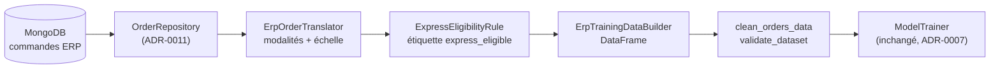

# ADR-0012 — Étiquette d'entraînement : règle métier dérivée des données de l'ERP

**Status :** Accepté (hypothèses métier à faire valider)
**Date :** 17/11/2026
**Séance :** 5, point *i* de la checklist (« entraîner le modèle sur des données de production »)

## Contexte

[ADR-0011](ADR-0011-source-donnees-postgresql-mongodb.md) a branché l'application sur la base analytique MongoDB en lecture seule. Mais l'entraînement ne pouvait pas encore l'utiliser, pour trois raisons :

1. **Pas de cible** : les commandes de l'ERP ne contiennent pas `express_eligible`, et aucune donnée de livraison réalisée n'est accessible.
2. **Vocabulaire différent** : `clear/rain/wind/snow`, `centre/suburb/rural`, `individual/business` côté ERP ; `normal/pluie/neige/orage`, `centre/proche_banlieue/banlieue/rurale`, `standard/premium` côté domaine et API.
3. **Échelle différente** : `carrier_capacity` va de 5 à 50 dans l'ERP, de 0 à 1 dans le modèle.

## Décision

1. **L'étiquette est dérivée par une règle métier explicite**, appliquée aux commandes ERP lues : `ExpressEligibilityRule` (`domain/express_eligibility.py`). Une commande est éligible si **aucun** des critères ci-dessous n'est violé.
2. **Le contrat de l'API ne change pas.** Les valeurs de l'ERP sont traduites vers le vocabulaire du domaine, à la frontière, par `ErpOrderTranslator` (`domain/order_translation.py`). Le modèle 1.1.0 et `openapi.yml` restent valables.
3. **L'entraînement choisit sa source** : `python scripts/train.py --source erp [--start …] [--end …]` ; `--source synthetic` reste le défaut. Le run MLflow porte le tag `data_source`.

### Critères d'éligibilité (hypothèses d'exploitation)

| Critère | Seuil | Raison métier supposée |
|---|---|---|
| `stock_available` | = 1 | Pas de livraison express sans produit en stock |
| `preparation_time_min` | ≤ 35 min | Au-delà, le délai express n'est plus tenable |
| `hour` | ≤ 17 | Dernier départ de coursier à 18 h |
| `weight_kg` | ≤ 20 kg | Colis transportable par un coursier |
| `weather` | ≠ `neige` | Conditions de circulation |
| `distance_km` | ≤ 35 (centre), 30 (banlieues), 20 (rurale) | Rayon d'action selon la zone |

Les seuils sont regroupés dans `EligibilityCriteria` : les changer ne touche pas la règle (ouvert/fermé).

### Correspondance ERP → domaine

| Variable | ERP | Domaine |
|---|---|---|
| `weather` | `clear`, `rain`, `snow`, `wind` | `normal`, `pluie`, `neige`, `orage` |
| `delivery_zone` | `centre`, `suburb`, `rural` | `centre`, `banlieue`, `rurale` |
| `customer_type` | `individual`, `business` | `standard`, `premium` |
| `carrier_capacity` | 5 à 50 | divisé par 50 → 0,1 à 1 |

`wind` n'a pas d'équivalent exact : il est rapproché de `orage` (météo dégradée sans précipitation franche). C'est une approximation assumée.

## Alternatives écartées

| Option | Pourquoi pas |
|---|---|
| Étiquette issue des **livraisons réalisées** | La donnée n'est pas accessible (ni dans PostgreSQL ni dans MongoDB). C'est la bonne cible à terme. |
| Variables ERP réelles + **cible synthétique** (tirage aléatoire) | Aucun lien avec la réalité : le modèle apprendrait du bruit. Une règle explicite est au moins lisible et discutable. |
| **Changer le contrat de l'API** pour parler ERP | Casse `openapi.yml`, les clients et le modèle 1.1.0 pour une simple différence de vocabulaire. |

## Conséquences

**Mesures** (5 000 commandes tirées comme le simulateur) :

| | Valeur |
|---|---|
| Commandes éligibles | 12,9 % (classe minoritaire, `class_weight="balanced"` déjà en place) |
| Critère le plus bloquant | stock indisponible (50 %), puis distance (29 %), préparation (26 %), météo (25 %) |
| ROC AUC / recall / precision | 0,95 / 0,92 / 0,46 |

**Limites à connaître**

- **Circularité.** Le modèle apprend une règle qu'on lui a écrite : ses métriques mesurent la fidélité à la règle, **pas** la performance réelle en livraison. Elles ne sont comparables ni à celles du modèle synthétique, ni à un futur modèle appris sur des livraisons réalisées.
- **Seuils non validés.** Ce sont des hypothèses d'exploitation à confirmer avec le métier avant toute mise en production.
- **Seules les commandes complètes servent** : celles qui ont des valeurs absentes (par ex. `preparation_time_min` avant juillet 2017) sont écartées par la validation de lecture ; celles qui ont une modalité inconnue sont écartées et comptées à la traduction.
- **Nouvelle version de modèle obligatoire** (`--version 2.0.0`) : une version publiée est immuable ([ADR-0002](ADR-0002-stockage-artefacts-modele.md)).
- Le fichier `.env` n'a pas besoin d'être modifié : `MONGO_URI` est déjà lue par `MongoSettings`.

## Critères de réexamen

- Les livraisons réalisées (délais effectifs) deviennent accessibles : remplacer la règle par la vraie cible, garder le traducteur.
- Le métier modifie un seuil ou ajoute un critère : modifier `EligibilityCriteria`, réentraîner, incrémenter la version.
- L'ERP change de vocabulaire : le test `test_every_erp_modality_has_a_translation` échoue avant tout entraînement.

Related: [ADR-0011](ADR-0011-source-donnees-postgresql-mongodb.md) · [ADR-0007](ADR-0007-suivi-experiences-mlflow.md) · [ADR-0002](ADR-0002-stockage-artefacts-modele.md) · [Architecture](../architecture.md) · [Journal](../journal/2026-11-17-donnees-erp-regle-metier.md) · [Index](../../INDEX.md)
