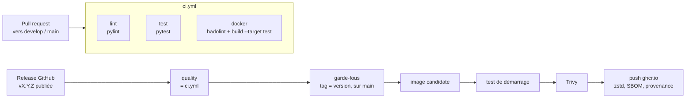

# Guide CI/CD (GitHub Actions)

Décision et justification : [ADR-0010](adr/ADR-0010-integration-continue-github-actions.md) · Historique : [Journal CI](journal/2026-10-29-github-actions.md) · Image : [Guide Docker](docker.md)

## Fichiers

| Fichier | Rôle |
|---|---|
| `.github/workflows/ci.yml` | pylint, pytest, hadolint + tests dans l'image — sur chaque pull request / push vers `main` et `develop` |
| `.github/workflows/release.yml` | à la publication d'une release : CI complète, garde-fous, test de démarrage, Trivy, publication sur ghcr.io |
| `.github/actions/setup-python-env/action.yml` | étape partagée : Python 3.13 + dépendances verrouillées |
| `.github/dependabot.yml` | mise à jour mensuelle des actions épinglées (pull request vers `develop`) |
| `pyproject.toml`, section `[tool.pylint]` | règles et seuil de pylint |
| `requirements/lint.in` → `requirements/lint.lock` | pylint et ses dépendances, versions + empreintes |



## Reproduire la CI en local

Mêmes commandes que les jobs (à la racine, environnement virtuel activé) :

```bash
pip install --require-hashes --no-deps -r requirements/test.lock -r requirements/lint.lock
pip install --no-deps -e .

pylint src scripts                                   # job lint (règles de pyproject.toml)
pylint tests --disable=missing-module-docstring,missing-class-docstring,missing-function-docstring,redefined-outer-name
python -m pytest -ra                                 # job test
docker build --target test .                         # job docker
```

PowerShell : mêmes commandes, sauf `docker build` qui demande Docker Desktop démarré.

Résultats au 29/10/2026 : pylint `src scripts` 9,22/10 (seuil 9,0 ; seules des docstrings manquent), pylint `tests` 10/10, pytest 68 tests OK.

## Seuil pylint

Dans `pyproject.toml` :

- `fail-on = ["E", "W", "F"]` : toute erreur ou alerte fait échouer la CI, quelle que soit la note ;
- `fail-under = 9.0` : la note minimale. Après avoir ajouté des docstrings, relever ce seuil (9,5, puis 10) pour ne pas revenir en arrière.

Désactiver une règle sur une ligne seulement, avec la raison juste au-dessus :

```python
# Import paresseux voulu : MLflow n'est pas installé dans l'image de l'API (ADR-0007)
import mlflow  # pylint: disable=import-outside-toplevel
```

## Mettre à jour pylint

```bash
uv pip compile requirements/lint.in -c requirements/constraints.txt \
  --generate-hashes --python-version 3.13 --universal --no-header -o requirements/lint.lock
```

## Configurer GitHub (une seule fois)

1. **Pousser les workflows sur `develop`** (pull request `feature/ci-github-actions` → `develop`) : le premier run apparaît dans l'onglet *Actions*.
2. **Rendre la CI obligatoire** : *Settings → Branches* (ou *Rules → Rulesets*) → règle de `main` et `develop` → *Require status checks to pass* → cocher `Analyse statique (pylint)`, `Tests (pytest)`, `Image Docker (hadolint + tests dans l'image)`. Les checks n'apparaissent dans la liste qu'après un premier run.
3. **Autoriser la publication** : *Settings → Actions → General → Workflow permissions* : laisser « Read repository contents » (les workflows demandent eux-mêmes `packages: write` là où c'est nécessaire).
4. **Après la première publication** : le paquet `industrialisation_ia_cloud` apparaît dans *Packages* (profil GitHub), privé. *Package settings* → *Change visibility* → Public (ou donner l'accès en lecture au compte qui déploie), et vérifier que le dépôt y est lié (*Manage Actions access*).

## Publier une version (image automatique)

Procédure Gitflow complète : [CONTRIBUTING.md](../CONTRIBUTING.md#publier-une-version). Pour la CI, l'important :

1. Dans `release/X.Y.Z`, mettre la même version dans `pyproject.toml` **et** `src/express_delivery/__init__.py`.
2. Après fusion dans `main` et pose du tag `vX.Y.Z` : *Releases → Draft a new release* → choisir le tag → *Generate release notes* → **Publish release** (ou `gh release create vX.Y.Z --generate-notes`).
3. Suivre le workflow *Release — image Docker* dans l'onglet *Actions*. Le résumé du run donne l'empreinte `sha256:…` à déployer.

Récupérer l'image :

```bash
docker pull ghcr.io/min3r0/industrialisation_ia_cloud:1.2.0
docker buildx imagetools inspect ghcr.io/min3r0/industrialisation_ia_cloud:1.2.0 --format '{{json .SBOM}}'   # SBOM
```

Une release marquée *pre-release* (`v1.2.0-rc.1`) publie seulement le tag `1.2.0-rc.1`, sans `latest`.

## Dépannage

| Symptôme | Cause / correctif |
|---|---|
| `Le tag vX.Y.Z ne correspond pas à la version du code` | mettre à jour `pyproject.toml` et `__init__.py`, nouvelle release |
| `Le commit tagué n'est pas sur main` | le tag a été posé sur `develop` ou `release/*` : supprimer le tag et la release, taguer `main` |
| Trivy échoue | lire le tableau du job ; mettre à jour la dépendance (fichiers `.lock`, [guide Docker](docker.md#mettre-à-jour-les-dépendances)) ou l'image de base, puis publier un correctif |
| `denied: permission_denied` au push | le paquet ghcr.io existe déjà sans lien avec le dépôt : *Package settings → Manage Actions access* → ajouter le dépôt en *Write* |
| Le job `lint` échoue sur la note | lancer `pylint src scripts` en local, corriger les messages signalés |
